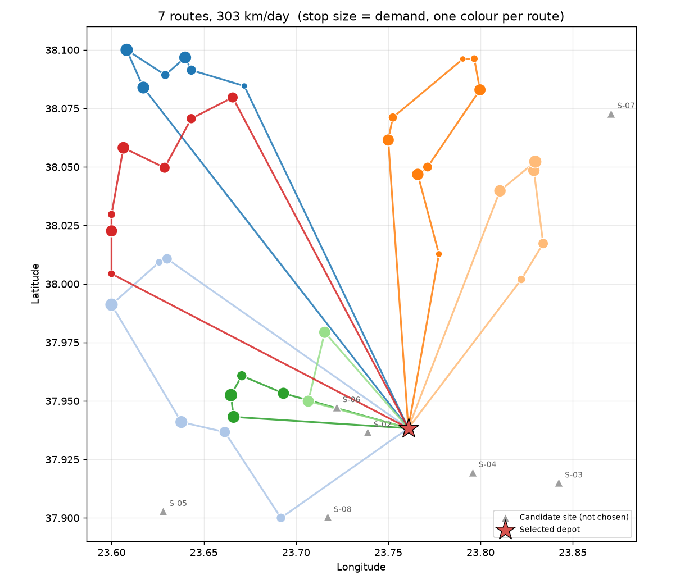

# Location & Routing Optimization

A small pipeline that generates a fake delivery network, validates it, and answers two linked
questions: **where should you put the next depot, and what routes should your vehicles drive from
it?** The input data, the ranked site options, the vehicle routes and a map are written into a single
Excel workbook.

It reuses the framing from portfolio optimization — *minimise a cost (or maximise a return) subject
to constraints* — in a new setting: here the cost is annual site + transport cost, and the constraints
are vehicle capacity and a maximum route duration.

The problem is solved in two nested layers:

1. **Location (facility location)** — every combination of `--num-sites` candidate sites is evaluated. Each customer is served by its nearest chosen depot, and the objective is
   `annual cost = site fixed costs + operating days × (km driven × cost per km + vehicles × daily vehicle cost)`.
2. **Routing (capacity-constrained vehicle routing, CVRP)** — solved separately for every depot:
   - **Clarke-Wright savings** — start with one route per customer, then repeatedly merge the two routes with the biggest distance saving, as long as vehicle capacity and the maximum route duration still hold.
   - **2-opt** — reorder the stops inside each route to remove crossing legs.

Because routing is solved for *every* candidate site, the location choice reflects real route costs, not a
straight-line proxy — and it captures the genuine trade-off between a cheap but remote site and a pricier, more central one.

> Distances are great-circle (haversine) kilometres × a circuity factor (default 1.3) to approximate road
> distance; travel time = distance ÷ average speed + service time at each stop. Savings and 2-opt are fast, well-known
> heuristics — typically within a few percent of the best possible routes, but not a proof of the global optimum.
> For real road networks, replace the distance matrix with one from a routing API or OSRM.

## How it works

Three scripts, run in order, each consuming the previous one's output:

1. **`generate_data.py`** — uses [Faker](https://faker.readthedocs.io/) to create a fake delivery network
   around greater Athens: customers (daily demand, service time) clustered in a few neighbourhoods, plus
   candidate depot sites with a yearly fixed cost (higher near the centre). It writes `data/locations_raw.csv`.
   A small percentage of rows are deliberately corrupted (out-of-range coordinates, negative demand, an unknown
   location type, blanks, a duplicate ID) so the next step has real errors to catch.
2. **`validate_data.py`** — checks every row in `data/locations_raw.csv` against the schema in
   `routing_common.py` (via [pydantic](https://docs.pydantic.dev/)), drops invalid or
   duplicate rows, and writes:
   - `data/locations_validated.csv` — the clean rows
   - `data/validation_report.txt` — what was rejected and why
3. **`analyze_routes.py`** — reads `data/locations_validated.csv`, picks the best site(s), plans the routes, and writes a
   new `output/routing_analysis.xlsx` workbook (plus `output/route_map.png`) with six sheets:
   - **Input Data** — the validated records the analysis ran on
   - **Site Comparison** — every site combination ranked by total annual cost (best highlighted)
   - **Routes** — one row per vehicle: load, distance, duration and stop sequence
   - **Route Stops** — the stop-by-stop plan for every route
   - **Summary** — key numbers, including the saving versus a naive plan that fills vehicles in the order customers appear in the data
   - **Route Map** — depots, stops (sized by demand) and one colour per route

`routing_common.py` holds the shared data model and file paths used by all three scripts.

> **Example Results** : [sample_results.xlsx](./sample_results.xlsx)
>
> 

## Setup

### 1. Get the code

```powershell
git clone <your-repo-url>
cd Location-routing-optimization
```

### 2. Create and activate a virtual environment

**Windows (PowerShell):**

```powershell
python -m venv .venv
.venv\Scripts\Activate.ps1
```

**macOS / Linux:**

```bash
python3 -m venv .venv
source .venv/bin/activate
```

### 3. Install dependencies

```powershell
pip install -r requirements.txt
```

Requires Python 3.10+ (uses PEP 604 type hints). The optimization itself is pure standard library;
`matplotlib` is only used for the map.

## Usage

Run the three scripts in order from the project root, with the virtual environment
activated:

```powershell
python generate_data.py --customers 40 --sites 8 --error-rate 0.05 --seed 42
python validate_data.py
python analyze_routes.py --num-sites 1
```

Then open `output/routing_analysis.xlsx`. Try `--num-sites 2` to see where a second depot would go.

### Options

| Script | Flag | Default | Description |
| --- | --- | --- | --- |
| `generate_data.py` | `--customers` | `40` | Number of delivery stops |
| | `--sites` | `8` | Number of candidate depot sites |
| | `--clusters` | `4` | Number of neighbourhood clusters the customers form |
| | `--error-rate` | `0.05` | Fraction of rows to deliberately corrupt (`0` for a perfectly clean dataset) |
| | `--seed` | none | Random seed, for reproducible output |
| | `--output` | `data/locations_raw.csv` | Where to write the raw data |
| `validate_data.py` | `--input` | `data/locations_raw.csv` | File to validate |
| | `--output` | `data/locations_validated.csv` | Where to write the cleaned data |
| | `--report` | `data/validation_report.txt` | Where to write the rejection report |
| `analyze_routes.py` | `--input` | `data/locations_validated.csv` | File to analyze |
| | `--output` | `output/routing_analysis.xlsx` | Where to write the results workbook |
| | `--map` | `output/route_map.png` | Where to write the route map |
| | `--num-sites` | `1` | How many depots to open |
| | `--vehicle-capacity` | `100` | Vehicle capacity in units |
| | `--max-route-hours` | `8` | Maximum driving + service time per route |
| | `--speed-kmh` | `30` | Average driving speed |
| | `--circuity` | `1.3` | Road distance ÷ straight-line distance |
| | `--cost-per-km` | `0.65` | Running cost per km driven |
| | `--vehicle-daily-cost` | `120` | Daily fixed cost of each vehicle and driver |
| | `--operating-days` | `250` | Delivery days per year |

Every script can also point at a custom input/output path, so you can drop in your own real
customer and candidate-site list (matching the columns in `routing_common.py`) and run it straight through
`validate_data.py` and `analyze_routes.py`, skipping `generate_data.py`. Site combinations are evaluated exhaustively,
so the number of combinations is capped at 2,000.

## Project layout

```
Location-routing-optimization/
├── routing_common.py       # shared schema + file paths
├── generate_data.py        # step 1: fake data generation
├── validate_data.py        # step 2: schema validation / cleaning
├── analyze_routes.py       # step 3: site selection + vehicle routing -> Excel + map
├── requirements.txt
├── data/                    # generated CSVs + validation report (not committed)
└── output/                  # generated Excel workbook + map (not committed)
```

`data/` and `output/` are gitignored (apart from `.gitkeep` placeholders) since their
contents are reproducible by re-running the scripts — as is `.venv/`, so the virtual
environment itself is never pushed to the repo.


> **Disclaimer** — This software is provided for educational and demonstration purposes only. See the full [Disclaimer & EULA](./DISCLAIMER.md) for details.
